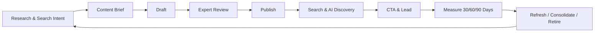

# แผนพัฒนาคลังความรู้และบทความ SEO / AEO / GEO
## บริษัท ดีถาวรการบัญชี จำกัด (Deethavorn Accounting Co., Ltd.)

> เวอร์ชัน 2.0 — ปรับปรุงวันที่ 10 ตุลาคม 2026  
> สถานะ: พร้อมใช้เป็นแผนดำเนินงานหลังยืนยัน Baseline และผู้รับผิดชอบเนื้อหา

---

## 1. เป้าหมายโครงการ

พัฒนา Knowledge Hub ด้านบัญชี ภาษี การตรวจสอบบัญชี การจดทะเบียนธุรกิจ และงานบุคคล เพื่อให้ผู้ประกอบการได้รับข้อมูลที่ถูกต้อง ตรวจสอบแหล่งอ้างอิงได้ และติดต่อบริษัทเมื่อจำเป็น โดยใช้แนวทางเดียวกันสำหรับการค้นหาผ่าน Search Engine, AI Overviews และ Generative AI Search

คำว่า **SEO / AEO / GEO** ในเอกสารนี้ใช้เป็นกรอบวางแผนการค้นพบเนื้อหา ไม่ใช่ระบบจัดอันดับแยกจากกัน และไม่ถือว่า schema, FAQ, Quick Answer หรือเครื่องมือใดสามารถรับประกันอันดับ การแสดง Rich Result หรือการถูก AI อ้างอิงได้

### 1.1 เป้าหมายทางธุรกิจ

1. สร้าง Organic Discovery จากคำค้นที่เกี่ยวข้องกับบริการและปัญหาจริงของลูกค้า
2. เปลี่ยนผู้อ่านเป็น Qualified Lead ผ่านโทรศัพท์ แบบฟอร์ม และ LINE Official Account
3. สร้างความน่าเชื่อถือด้วยเนื้อหาที่เขียนหรือทบทวนโดยผู้เชี่ยวชาญจริง
4. ลดภาระการตอบคำถามซ้ำด้วยบทความที่ใช้เป็นแหล่งอ้างอิงของทีมงานและลูกค้า
5. สร้างกระบวนการผลิต ตรวจสอบ เผยแพร่ และทบทวนเนื้อหาที่ทำซ้ำได้

### 1.2 เป้าหมายที่ควบคุมและตรวจรับได้

- หน้าที่เผยแพร่ทุกหน้าตอบกลับ HTTP 200 มี canonical ถูกต้อง และอยู่ใน sitemap
- เนื้อหาสำคัญแสดงเป็น HTML ที่ crawler และผู้ใช้เข้าถึงได้โดยไม่ต้องรัน interaction เพิ่มเติม
- บทความทุกบทมีผู้เขียน ผู้ตรวจสอบ วันที่เผยแพร่ วันที่ทบทวน และแหล่งอ้างอิงที่ตรวจสอบได้
- Event ของ CTA, โทรศัพท์, LINE และแบบฟอร์มถูกบันทึกพร้อมแหล่งที่มาของ session
- ไม่มีบทความ Draft หรือ Preview หลุดเข้า index
- มีรายงาน Search Console, Bing Webmaster Tools และ Analytics สำหรับรอบ 30/60/90 วัน

### 1.3 ผลลัพธ์ที่ไม่รับประกัน

- อันดับหน้าแรกของ Google หรือ Bing
- Featured Snippet, People Also Ask, FAQ Rich Result หรือ AI Overview
- การถูก ChatGPT, Gemini, Claude, Perplexity หรือระบบ AI อื่นอ้างอิง
- ปริมาณ Lead ที่แน่นอนก่อนมีข้อมูล Baseline

ผลลัพธ์เหล่านี้ใช้เป็น Outcome สำหรับติดตามและปรับปรุง ไม่ใช้เป็นเกณฑ์ตรวจรับงานพัฒนาระบบ

---

## 2. แนวทางส่งมอบแบบลดความเสี่ยง

ก่อนสร้าง CMS เต็มระบบ ให้ทำ **Vertical Pilot** จำนวน 3–5 บทความ โดยเชื่อมเส้นทางครบตั้งแต่เนื้อหา → หน้าอ่าน → metadata/schema → sitemap → CTA → analytics เพื่อทดสอบ workflow และคุณภาพก่อนลงทุนกับเครื่องมือหลังบ้านทั้งหมด

หากทีมงานเผยแพร่บทความไม่เกิน 1–2 บทความต่อเดือน สามารถใช้ Markdown ที่ review ผ่าน Git หรือแบบฟอร์มหลังบ้านขนาดเล็กในระยะแรกได้ แล้วค่อยเพิ่ม CMS เต็มรูปแบบเมื่อพิสูจน์ว่ามีความต้องการใช้งานจริง



---

## 3. Phase 0 — Baseline, Audience และ Content Strategy

Phase นี้ต้องเสร็จก่อนกำหนด KPI เชิงตัวเลขและก่อนเขียนบทความชุดแรก

### 3.1 Baseline ทางเทคนิคและการค้นหา

- ยืนยันโดเมนหลักและ canonical host เช่น `https://deethavorn.com`
- เชื่อม Google Search Console และ Bing Webmaster Tools
- บันทึกจำนวนหน้าที่ index, crawl errors, impressions, clicks, CTR และคำค้นปัจจุบัน
- ตรวจสถานะ `/robots.txt`, `/sitemap.xml`, canonical, redirect และ HTTP status
- บันทึก Core Web Vitals และ Lighthouse ก่อนเริ่มงาน
- ตรวจ referral จาก Search, ChatGPT และช่องทางอื่นใน Analytics

### 3.2 กลุ่มผู้อ่านหลัก

1. เจ้าของ SME ที่กำลังเริ่มธุรกิจหรือเปลี่ยนสำนักงานบัญชี
2. บริษัทที่ต้องจัดการ VAT, ภาษีหัก ณ ที่จ่าย และภาษีเงินได้นิติบุคคล
3. ธุรกิจที่ต้องตรวจสอบบัญชีหรือเลือก CPA/TA
4. นายจ้างที่ต้องจัดการ Payroll, ภ.ง.ด.1 และประกันสังคม
5. ผู้ประกอบการที่ต้องการคำตอบเร่งด่วนก่อนติดต่อผู้เชี่ยวชาญ

### 3.3 Topic Cluster เริ่มต้น

| Cluster | ตัวอย่าง Search Intent | Service CTA |
| --- | --- | --- |
| จดทะเบียนธุรกิจ | ขั้นตอน เอกสาร ค่าใช้จ่าย บริษัท vs หจก. | ขอคำปรึกษาจดทะเบียน |
| VAT และภาษีรายเดือน | เกณฑ์ VAT, ภ.พ.30, ภ.ง.ด.1/3/53 | ขอให้ตรวจภาษีรายเดือน |
| ภาษีนิติบุคคล | ภ.ง.ด.50, ภ.ง.ด.51, ค่าใช้จ่ายต้องห้าม | นัดวางแผนภาษี |
| บัญชีรายเดือน | เอกสารบัญชี ปิดงบ กระแสเงินสด | ขอใบเสนอราคาทำบัญชี |
| ตรวจสอบบัญชี | CPA vs TA, เอกสารตรวจสอบ, กำหนดเวลา | ขอใบเสนอราคาสอบบัญชี |
| Payroll และ HR | เงินเดือน OT ภ.ง.ด.1 ประกันสังคม | ปรึกษาระบบเงินเดือน |

### 3.4 Content Brief บังคับก่อนเขียน

ทุกบทความต้องระบุ:

- กลุ่มผู้อ่านและงานที่ต้องการทำให้สำเร็จ
- Primary intent และคำถามรอง ไม่บังคับจำนวน keyword
- ขอบเขตคำตอบและสิ่งที่บทความไม่ครอบคลุม
- มุมมองหรือประสบการณ์เฉพาะของบริษัทที่หาไม่ได้จากบทความทั่วไป
- แหล่งกฎหมาย/หน่วยงานต้นทางและวันที่ตรวจสอบ
- ผู้เขียน ผู้ตรวจสอบ และกำหนดวันทบทวนครั้งถัดไป
- Primary CTA หนึ่งรายการและ Secondary CTA ไม่เกินหนึ่งรายการ
- บทความต้นทางและปลายทางสำหรับ internal link

### 3.5 KPI หลังเก็บ Baseline

กำหนดตัวเลขเป้าหมายหลังมีข้อมูลจริง โดยติดตามอย่างน้อย:

- จำนวนหน้าที่ Valid และ Indexed
- Non-brand impressions, clicks และ CTR แยกตาม cluster
- CTA click-through rate และ Qualified Lead conversion rate
- Form submission, click-to-call และ LINE click ตามบทความ
- Landing pages ที่สร้าง Lead และ assisted conversion
- Referral traffic จาก Search Engine และ AI Search
- จำนวนบทความที่ครบกำหนดทบทวนหรือมีข้อมูลล้าสมัย

---

## 4. Editorial Governance และความน่าเชื่อถือ

เนื้อหาบัญชีและภาษีอาจส่งผลต่อการตัดสินใจทางการเงิน จึงต้องเน้นความถูกต้องและความรับผิดชอบมากกว่าการผลิตจำนวนมาก

### 4.1 Workflow การเผยแพร่

```text
DRAFT → IN_REVIEW → APPROVED → PUBLISHED → ARCHIVED
```

- ผู้เขียนสร้างหรือแก้ไข Draft ได้ แต่เผยแพร่เองไม่ได้หากไม่มีสิทธิ์ `article:publish`
- ผู้ตรวจสอบต้องเป็นบุคคลจริงที่มีความรู้ตรงกับหัวข้อ
- การแก้สาระสำคัญหลังเผยแพร่ต้องกลับเข้า `IN_REVIEW`
- การแก้ typo หรือรูปแบบเล็กน้อยไม่เปลี่ยน `contentUpdatedAt`
- บทความที่กฎหมายหรืออัตราภาษีเปลี่ยนต้องถูกแจ้งเตือนให้ทบทวน
- การ Archive ต้องรักษา redirect หรือแสดงคำอธิบายที่เหมาะสม ห้ามปล่อย 404 โดยไม่มีแผน

### 4.2 ข้อมูลผู้เขียนและผู้ตรวจสอบ

- ใช้ชื่อบุคคลหรือองค์กรจริง ห้ามใช้ profile หรือ credential ที่สร้างขึ้นเพื่อ SEO
- มีหน้า `/authors/[slug]` แสดงประวัติ ความเชี่ยวชาญ ใบอนุญาตหรือสถานะวิชาชีพที่เปิดเผยได้
- `Article` schema ต้องเชื่อม `author.url` ไปยังหน้า profile
- แยกบทบาท “เขียนโดย” และ “ตรวจสอบโดย” ให้ชัดเจน
- แสดงวันที่เผยแพร่ วันที่แก้ไขสาระสำคัญ และวันที่ตรวจสอบล่าสุด

### 4.3 แหล่งอ้างอิง

- อ้างอิงแหล่งต้นทาง เช่น กรมสรรพากร, DBD, กระทรวงแรงงาน, สำนักงานประกันสังคม และสภาวิชาชีพบัญชี
- เก็บชื่อเอกสาร หน่วยงาน URL วันที่ประกาศ/แก้ไข และวันที่เข้าถึง
- ลิงก์แหล่งอ้างอิงจากข้อความที่เกี่ยวข้อง ไม่รวมเป็นข้อความยาวช่องเดียว
- เมื่อแหล่งอ้างอิงเปลี่ยน ให้บันทึก revision และทบทวนข้อสรุปของบทความ

---

## 5. โครงสร้างข้อมูล

ใช้ Prisma Migration เพื่อสร้างและเปลี่ยน schema โดยใช้ `prisma migrate dev` ในเครื่องพัฒนา และ `prisma migrate deploy` บน staging/production ห้ามใช้ `prisma db push` เป็น deployment workflow ของ production

โครงสร้างต่อไปนี้เป็น baseline สำหรับ implementation อาจปรับชื่อ relation ตามข้อจำกัดของ schema ปัจจุบันก่อนสร้าง migration

```prisma
enum ArticleStatus {
  DRAFT
  IN_REVIEW
  APPROVED
  PUBLISHED
  ARCHIVED
}

model Author {
  id               Int       @id @default(autoincrement())
  name             String    @db.VarChar(120)
  slug             String    @unique @db.VarChar(160)
  role             String?   @db.VarChar(160)
  bio              String?   @db.Text
  credentials      String?   @db.Text
  profileImage     String?   @map("profile_image") @db.VarChar(255)
  sameAs           Json?     @map("same_as")
  isActive         Boolean   @default(true) @map("is_active")
  authoredArticles Article[] @relation("ArticleAuthor")
  reviewedArticles Article[] @relation("ArticleReviewer")
  createdAt        DateTime  @default(now()) @map("created_at")
  updatedAt        DateTime  @updatedAt @map("updated_at")

  @@map("authors")
}

model Article {
  id               Int               @id @default(autoincrement())
  title            String            @db.VarChar(255)
  slug             String            @unique @db.VarChar(255)
  summary          String            @db.VarChar(500)
  contentMarkdown  String            @map("content_markdown") @db.LongText
  category         String            @db.VarChar(80)
  coverImage       String?           @map("cover_image") @db.VarChar(255)
  coverImageAlt    String?           @map("cover_image_alt") @db.VarChar(255)
  quickAnswer      String?           @map("quick_answer") @db.Text
  status           ArticleStatus     @default(DRAFT)
  authorId         Int?              @map("author_id")
  author           Author?           @relation("ArticleAuthor", fields: [authorId], references: [id])
  reviewerId       Int?              @map("reviewer_id")
  reviewer         Author?           @relation("ArticleReviewer", fields: [reviewerId], references: [id])
  reviewedAt       DateTime?         @map("reviewed_at")
  publishedAt      DateTime?         @map("published_at")
  contentUpdatedAt DateTime?         @map("content_updated_at")
  nextReviewAt     DateTime?         @map("next_review_at")
  createdAt        DateTime          @default(now()) @map("created_at")
  updatedAt        DateTime          @updatedAt @map("updated_at")
  faqs             ArticleFaq[]
  citations        ArticleCitation[]
  redirects        ArticleRedirect[]

  @@index([status, publishedAt])
  @@index([category, status])
  @@map("articles")
}

model ArticleFaq {
  id        Int     @id @default(autoincrement())
  articleId Int     @map("article_id")
  article   Article @relation(fields: [articleId], references: [id], onDelete: Cascade)
  question  String  @db.VarChar(255)
  answer    String  @db.Text
  sortOrder Int     @default(0) @map("sort_order")

  @@index([articleId, sortOrder])
  @@map("article_faqs")
}

model ArticleCitation {
  id            Int       @id @default(autoincrement())
  articleId     Int       @map("article_id")
  article       Article   @relation(fields: [articleId], references: [id], onDelete: Cascade)
  title         String    @db.VarChar(255)
  publisher     String?   @db.VarChar(160)
  url           String    @db.VarChar(1000)
  referenceDate DateTime? @map("reference_date") @db.Date
  accessedAt    DateTime? @map("accessed_at") @db.Date
  sortOrder     Int       @default(0) @map("sort_order")

  @@index([articleId, sortOrder])
  @@map("article_citations")
}

model ArticleRedirect {
  id        Int      @id @default(autoincrement())
  fromSlug  String   @unique @map("from_slug") @db.VarChar(255)
  articleId Int      @map("article_id")
  article   Article  @relation(fields: [articleId], references: [id], onDelete: Cascade)
  createdAt DateTime @default(now()) @map("created_at")

  @@index([articleId])
  @@map("article_redirects")
}
```

### 5.1 กติกาสำคัญของข้อมูล

- ไม่เก็บ `views` ใน `Article`; ใช้ Analytics หรือ event table แยก เพื่อไม่ให้ `updatedAt` เปลี่ยนทุกครั้งที่มีคนอ่าน
- `publishedAt` คือวันเผยแพร่ครั้งแรก ไม่ใช้ `createdAt`
- `contentUpdatedAt` เปลี่ยนเฉพาะเมื่อสาระสำคัญที่ผู้ใช้เห็นเปลี่ยน
- slug ที่เปลี่ยนต้องสร้าง `ArticleRedirect` และตอบกลับ 301 ไปยัง canonical ใหม่
- FAQ ต้องแสดงต่อผู้ใช้จริงหากมี structured data ห้ามสร้าง FAQ สำหรับ bot อย่างเดียว
- Draft, In Review, Approved และ Archived ไม่อยู่ใน public query หรือ sitemap

---

## 6. รูปแบบเนื้อหาและความปลอดภัย

### 6.1 Content Format

ใช้ **Markdown แบบจำกัดความสามารถ** เป็นรูปแบบหลัก ห้ามรับ MDX หรือ JavaScript จาก editor เพื่อป้องกันการรันโค้ดจากเนื้อหา

Renderer ต้องรองรับ:

- Paragraph, heading `h2–h4`, ordered/unordered list
- Table, blockquote, strong/emphasis และ code แบบ inline เมื่อจำเป็น
- Internal/external link พร้อม validation protocol
- รูปภาพพร้อม alt text, caption, width และ height
- Heading ID ที่เสถียรสำหรับ Table of Contents
- การ sanitize HTML ด้วย allowlist ก่อน render

ห้ามอนุญาต `<script>`, event handler, `javascript:` URL, iframe ที่ไม่อยู่ใน allowlist และ raw HTML ที่ไม่ผ่าน sanitizer

### 6.2 Media Upload

- อนุญาตเฉพาะ JPG, PNG, WebP และ AVIF สำหรับภาพบทความ
- ตรวจ MIME จากเนื้อไฟล์ ไม่เชื่อเฉพาะนามสกุลหรือ header
- จำกัดขนาดไฟล์และ dimensions พร้อมสร้างไฟล์ optimized
- บังคับกรอก alt text ก่อนเผยแพร่
- เก็บไฟล์ production ใน object storage หรือ persistent directory นอก release directory
- ใช้ชื่อไฟล์แบบสุ่มและห้ามนำชื่อไฟล์จากผู้ใช้ไปใช้เป็น path โดยตรง

---

## 7. โครงสร้างระบบ

```text
src/
├── app/
│   ├── (admin)/admin/articles/
│   │   ├── page.tsx
│   │   ├── new/page.tsx
│   │   └── [id]/page.tsx
│   ├── api/admin/articles/
│   │   ├── route.ts
│   │   ├── [id]/route.ts
│   │   ├── [id]/submit/route.ts
│   │   ├── [id]/approve/route.ts
│   │   └── [id]/publish/route.ts
│   ├── api/admin/uploads/article-cover/route.ts
│   ├── knowledge/
│   │   ├── page.tsx
│   │   └── [slug]/
│   │       ├── page.tsx
│   │       └── opengraph-image.tsx
│   ├── authors/[slug]/page.tsx
│   ├── sitemap.ts
│   └── robots.ts
├── components/articles/
│   ├── ArticleCard.tsx
│   ├── ArticleBody.tsx
│   ├── ArticleToc.tsx
│   ├── ArticleFaq.tsx
│   ├── ArticleCitations.tsx
│   ├── ArticleAuthor.tsx
│   └── ArticleCta.tsx
└── lib/articles/
    ├── queries.ts
    ├── validation.ts
    ├── markdown.ts
    ├── permissions.ts
    └── analytics.ts
```

### 7.1 RBAC

เพิ่ม permissions ใน Role seed และตรวจซ้ำภายใน API ทุก endpoint:

```text
article:view
article:create
article:edit
article:review
article:publish
article:archive
article:delete
```

Middleware ใช้ป้องกัน authentication เท่านั้น ส่วน authorization ต้องตรวจด้วย `getAdminSession()` และ `hasPermission()` ใน API เพื่อไม่ให้การเรียก endpoint โดยตรงข้ามสิทธิ์ได้

### 7.2 Validation และ Audit

- Validate request body ฝั่ง server ทุกครั้ง
- Slug ต้อง normalize และตรวจ uniqueness
- ตรวจความสัมพันธ์ระหว่าง status, reviewer, reviewedAt และ publishedAt
- บันทึกผู้สร้าง ผู้แก้ไข ผู้อนุมัติ และเวลาที่ดำเนินการ
- Delete ใช้ soft delete/archive เป็นค่าเริ่มต้น; hard delete จำกัดเฉพาะ Super Admin
- API error ไม่เปิดเผย stack trace หรือข้อมูลภายใน

---

## 8. Public Reader Experience

หน้า `/knowledge/[slug]` ต้องออกแบบเพื่อช่วยผู้อ่านก่อน แล้วจึงเสริมข้อมูลสำหรับ Search และ AI

```text
Breadcrumbs
Category • Published date • Last expert review
H1
Written by [Author] • Reviewed by [Reviewer]
Cover image

Quick answer / Key takeaways (เมื่อเหมาะกับหัวข้อ)
Table of contents
Article body with examples, tables and internal links
Limitations / cases that require professional advice
FAQ visible to users
Citations and source dates
Author and reviewer profiles
Primary CTA
Related articles selected by intent/cluster
```

### 8.1 Content UX

- มี H1 หนึ่งรายการ และใช้ heading ตามลำดับ
- Quick Answer ไม่บังคับ 40–60 คำ หากคำตอบที่ถูกต้องต้องสั้นหรือยาวกว่า
- CTA ต้องสอดคล้องกับ intent และไม่รบกวนการอ่าน
- ตารางต้องอ่านได้บนมือถือและมีคำอธิบายหัวตาราง
- วันที่แสดงต้องมาจาก `publishedAt`, `contentUpdatedAt` และ `reviewedAt`
- ข้อความทางภาษีหรือกฎหมายต้องมี disclaimer ว่าเป็นข้อมูลทั่วไป ไม่ใช่คำปรึกษาเฉพาะกรณี

---

## 9. Technical SEO, AEO และ GEO

### 9.1 Metadata และ Indexability

- ใช้ `generateMetadata()` จากข้อมูลบทความที่ `PUBLISHED` เท่านั้น
- บทความที่ไม่พบหรือไม่เผยแพร่ต้องเรียก `notFound()` ไม่คืนหน้า 200 พร้อมข้อความว่าไม่พบ
- กำหนด `metadataBase` จาก environment ที่ validate แล้ว
- title และ description ใช้ preview เป็นแนวทาง ไม่บังคับจำนวนตัวอักษรตายตัว
- กำหนด canonical เป็น URL ปัจจุบันหลัง resolve redirect
- กำหนด Open Graph/Twitter image, published time, modified time และ author
- Preview และ Admin ใช้ `noindex, nofollow` และยังต้องมี authentication

### 9.2 Structured Data

ใช้ JSON-LD ที่ตรงกับเนื้อหาซึ่งผู้ใช้มองเห็น:

1. `Article` หรือ `BlogPosting`
2. `BreadcrumbList`
3. `Organization` / `AccountingService` ในระดับเว็บไซต์
4. `ProfilePage` สำหรับหน้าผู้เขียนเมื่อข้อมูลครบ
5. `FAQPage` เฉพาะเมื่อ FAQ แสดงบนหน้าและข้อมูลตรงกัน

FAQ มีไว้ช่วยผู้อ่านและอธิบายบริบท ไม่ใช้ FAQ Rich Result เป็น KPI เพราะการแสดงผลขึ้นกับสิทธิ์และการตัดสินใจของ Search Engine

`Article` schema ควรมี:

- `headline`, `description`, `image`
- `datePublished`, `dateModified`
- `author` พร้อม `@type`, `name`, `url`
- `publisher` พร้อม logo ที่ crawl ได้
- `mainEntityOfPage`

### 9.3 Sitemap

- รวมเฉพาะ canonical URL ที่เผยแพร่และตอบกลับ 200
- ไม่ใส่ URL fragment เช่น `/#services`
- ใช้ `lastModified = contentUpdatedAt ?? publishedAt`
- ไม่เปลี่ยน `lastModified` จากยอดวิวหรือการแก้ข้อมูลหลังบ้านที่ผู้ใช้ไม่เห็น
- ไม่พึ่ง `priority` หรือ `changeFrequency` เป็นสัญญาณอันดับ

### 9.4 Robots และ AI Crawlers

- `robots.txt` ไม่ใช่ระบบรักษาความปลอดภัย; `/admin` และ `/api/admin` ต้องป้องกันด้วย authentication/authorization
- บล็อก `/admin/`, `/api/` และ preview routes จาก crawler ทั่วไป
- อนุญาต Googlebot และ Bingbot เข้าถึง public content
- อนุญาต `OAI-SearchBot` หากต้องการมีสิทธิ์ปรากฏใน ChatGPT Search
- ตัดสินใจนโยบาย `GPTBot` แยกจาก `OAI-SearchBot` เพราะ Search discovery และ model training เป็นคนละวัตถุประสงค์
- ตรวจ CDN/WAF ว่าไม่บล็อก crawler ที่อนุญาตโดยไม่ตั้งใจ

### 9.5 Performance

ใช้ Lighthouse เป็น lab test และใช้ข้อมูลภาคสนามเมื่อมี traffic เพียงพอ:

- LCP ≤ 2.5 วินาที
- INP < 200 มิลลิวินาที
- CLS < 0.1
- ประเมินที่ 75th percentile แยก mobile/desktop เมื่อมีข้อมูลจริง
- Lighthouse SEO ≥ 95 และไม่มี critical accessibility error

### 9.6 Internal Linking และ Content Lifecycle

- `/knowledge` ต้องใช้ลิงก์ `<a>` จริงไปยังบทความ ห้ามใช้ `href="#"`
- ทุกบทความมีอย่างน้อย 2 internal links ที่มีเหตุผลเชิงเนื้อหาเมื่อมีหน้าปลายทางเพียงพอ
- Related articles เลือกจาก intent/cluster ไม่เลือกจาก category อย่างเดียว
- เมื่อรวมบทความซ้ำ ให้ redirect URL เก่าไปหน้าหลัก
- เมื่อข้อมูลหมดอายุ ให้ update, consolidate หรือ archive พร้อมเหตุผลและ redirect ที่เหมาะสม

---

## 10. Admin Editor

### 10.1 ฟังก์ชันจำเป็น

- Article list พร้อม filter ตาม status, category, author และ review due date
- Markdown editor พร้อม preview ที่ใช้ renderer เดียวกับ public page
- Slug editor พร้อมคำเตือนและการสร้าง redirect เมื่อเปลี่ยน slug
- Author, reviewer, citation และ FAQ editor
- Cover image upload พร้อม alt text
- Submit for review, approve, publish, archive ตาม permission
- แสดง validation errors ที่บล็อกการเผยแพร่
- แสดงประวัติผู้แก้ไขและสถานะล่าสุด

### 10.2 Content Quality Assistant

เครื่องมือต่อไปนี้เป็นคำแนะนำ ไม่ใช่คะแนนรับประกันอันดับ:

- SERP preview แบบประมาณการ
- ตรวจ H1/H2 structure, ลิงก์เสีย, alt text และ citation ที่ไม่ครบ
- แจ้งเตือน title/description ที่สั้นหรือยาวผิดปกติโดยไม่บังคับ threshold ตายตัว
- ตรวจ Quick Answer ว่าตอบคำถามจริง ไม่บังคับจำนวนคำ
- ตรวจ FAQ ซ้ำหรือคำตอบที่ไม่มีหลักฐานรองรับ
- ตรวจบทความที่ใกล้ถึง `nextReviewAt`

---

## 11. Analytics และ Conversion Measurement

### 11.1 Events

กำหนด event อย่างน้อย:

```text
article_view
article_cta_click
article_line_click
article_phone_click
article_form_start
article_form_submit
article_share
```

Event ต้องส่ง `article_slug`, `article_category`, `cta_type` และ referrer/source ที่เหมาะสม โดยไม่ส่งข้อมูลส่วนบุคคลที่ไม่จำเป็น

### 11.2 Lead Attribution

- ส่ง source article ไปกับ contact form ด้วย hidden field ที่ server validate
- ใส่ UTM ในลิงก์ campaign ภายนอก
- แยก Brand vs Non-brand ใน Search Console report
- ตรวจ referral เช่น `chatgpt.com`, Search Engine และ social โดยไม่สรุปว่า referral ทุกครั้งเป็นการอ้างอิงจาก AI
- ปฏิบัติตาม PDPA และ consent policy ของระบบ analytics ที่เลือกใช้

### 11.3 รอบรายงาน

- 7 วันแรก: ตรวจ indexing, crawl, metadata และ event delivery
- 30 วัน: ตรวจ impressions, queries, CTR, engagement และ conversion path
- 60 วัน: ปรับ title/summary, internal links และ CTA จากข้อมูลจริง
- 90 วัน: ตัดสินใจ expand, refresh, consolidate หรือหยุด cluster ที่ไม่สร้างคุณค่า

---

## 12. Roadmap การดำเนินงาน

| Phase | งานหลัก | Exit Criteria |
| --- | --- | --- |
| **0 — Discovery & Baseline** | เชื่อม measurement, audit technical SEO, กำหนด audience/topic cluster/content briefs | มี baseline report, owner, KPI definition และ 3–5 approved briefs |
| **1 — Vertical Pilot** | ทำหน้า article detail, Markdown renderer, metadata, Article/Breadcrumb schema, CTA และ analytics สำหรับบทความนำร่อง | เส้นทาง Content → Indexability → CTA → Event ทำงานครบ |
| **2 — Data & Workflow** | สร้าง Prisma migrations, Author/Reviewer/Citation/FAQ/Redirect, publication state และ permissions พร้อมปรับ package scripts/คู่มือ deploy ให้ใช้ migration | Migration ผ่าน staging, Draft ไม่ public, publish ต้องผ่าน permission |
| **3 — Admin Portal** | Article list/editor/review/publish/media upload และ validation | เจ้าหน้าที่ทำ workflow ตั้งแต่ Draft ถึง Publish ได้โดยไม่แก้โค้ด |
| **4 — Technical Hardening** | Sitemap, robots/crawler policy, redirects, cache/revalidation, security และ performance | ไม่มี critical SEO/security issue และ Core Web Vitals lab target ผ่าน |
| **5 — Launch & QA** | Deploy migration, seed approved content, Rich Results Test, URL Inspection, social preview และ smoke/E2E test | Production พร้อมใช้งานและ monitoring ทำงาน |
| **6 — Operate 30/60/90** | วิเคราะห์ query/conversion, refresh content และปรับ cluster | มีรายงานผลและ backlog รอบถัดไปจากข้อมูลจริง |

---

## 13. Testing และ Verification

### 13.1 Automated Tests

- Validation ของ slug, status transition, citations และ publish requirements
- Permission tests สำหรับทุก article API action
- Markdown sanitization และ malicious URL/HTML cases
- Public query คืนเฉพาะ `PUBLISHED` และ `publishedAt <= now`
- Metadata, canonical และ JSON-LD snapshot/contract tests
- Sitemap ไม่รวม Draft, Archived, redirect source หรือ fragment URL
- Redirect เก่าตอบ 301 ไป canonical ใหม่
- CTA และ form attribution event ทำงาน

### 13.2 Manual QA

- Mobile/desktop reader experience และ keyboard navigation
- Google Rich Results Test สำหรับ Article/Breadcrumb
- Search Console URL Inspection หลัง deploy
- Social preview บน LINE และ Facebook
- ตรวจ author/reviewer/citation กับข้อมูลที่แสดงจริง
- ทดสอบเปลี่ยน slug, archive และ restore
- ทดสอบ upload ไฟล์ผิดชนิด เกินขนาด และไฟล์ที่มี MIME ไม่ตรง

### 13.3 Production Checks

- สำรองฐานข้อมูลก่อน `prisma migrate deploy`
- ตรวจ migration status และ rollback/forward-fix procedure
- ตรวจ 404/500, application logs และ database errors
- ตรวจ `/robots.txt`, `/sitemap.xml`, canonical และ response headers จาก production URL
- ตรวจว่า WAF/CDN ไม่บล็อก crawler ที่อนุญาต

---

## 14. Acceptance Criteria

### 14.1 Content และ Editorial

- บทความนำร่องอย่างน้อย 3 บทผ่านการตรวจโดยผู้เชี่ยวชาญจริง
- ทุกบทมี author, reviewer, citations, publishedAt, reviewedAt และ nextReviewAt
- ไม่มี generic/fabricated author profile หรือ credential
- Content Brief และ Primary CTA ครบทุกบท

### 14.2 Functional และ Security

- Admin สร้าง แก้ไข ส่งตรวจ อนุมัติ เผยแพร่ Archive และเปลี่ยน slug ได้ตามสิทธิ์
- ผู้ไม่มี `article:publish` เรียก publish API โดยตรงไม่ได้
- Draft/Preview ไม่ปรากฏใน public query, sitemap หรือ search index
- Markdown/HTML ที่เป็นอันตรายไม่ถูกรันใน browser
- Upload validation และ persistent storage ทำงานตามข้อกำหนด

### 14.3 Search และ Technical

- Published URL ตอบ 200; slug เดิมตอบ 301; missing URL ตอบ 404
- Canonical, metadata, OG image, Article และ Breadcrumb schema ตรงกับข้อมูลที่แสดง
- Sitemap มีเฉพาะ canonical published URLs และ `lastModified` ที่เชื่อถือได้
- ไม่มี URL fragment ใน sitemap
- Admin/Preview มี `noindex` และมี authentication
- Google Rich Results Test ไม่มี critical error สำหรับ schema ที่รองรับ

### 14.4 Performance และ Accessibility

- Lighthouse SEO ≥ 95 บนหน้าตัวอย่างที่กำหนด
- ไม่มี critical accessibility issue ใน reader flow
- LCP ≤ 2.5s, INP < 200ms และ CLS < 0.1 ใน lab; ยืนยันภาคสนามเมื่อมีข้อมูลเพียงพอ
- รูปภาพมี dimensions, alt text และ optimization

### 14.5 Measurement

- Events ที่กำหนดปรากฏใน Analytics debug/realtime report
- Form lead เก็บ source article โดยไม่ทำลายข้อมูลเดิม
- Search Console และ Bing Webmaster Tools รับ sitemap สำเร็จ
- มี dashboard หรือรายงาน baseline และ template รอบ 30/60/90 วัน

---

## 15. Risks และ Mitigations

| Risk | ผลกระทบ | Mitigation |
| --- | --- | --- |
| ข้อมูลภาษี/กฎหมายล้าสมัย | ความน่าเชื่อถือและลูกค้าเสียหาย | reviewer, citations, nextReviewAt, content refresh alert |
| บทความถูกเผยแพร่ก่อนตรวจ | ข้อมูลผิดเข้าสู่ index | default DRAFT, status transition, separate publish permission |
| เปลี่ยน slug แล้ว traffic หาย | 404 และสูญเสีย authority | redirect table และ automated 301 test |
| HTML จาก editor ไม่ปลอดภัย | Stored XSS | restricted Markdown และ allowlist sanitizer |
| Sitemap ส่งสัญญาณวันแก้ไขผิด | crawler เสียเวลาและข้อมูลไม่น่าเชื่อถือ | แยก contentUpdatedAt จาก updatedAt และ analytics |
| ผล SEO ไม่เกิดตามคาด | ลงทุนเกินผลตอบแทน | vertical pilot, baseline และ decision gate 30/60/90 วัน |
| AI crawler ถูก WAF บล็อก | เนื้อหาไม่ถูก discover | crawler policy, log review และ IP/user-agent verification |
| Production schema drift | deploy ล้มเหลวหรือข้อมูลเสียหาย | versioned migrations, staging test และ database backup |

---

## 16. เอกสารอ้างอิงมาตรฐาน

- [Google: AI features and your website](https://developers.google.com/search/docs/appearance/ai-features)
- [Google: Optimizing for generative AI features](https://developers.google.com/search/docs/fundamentals/ai-optimization-guide)
- [Google: Creating helpful, reliable, people-first content](https://developers.google.com/search/docs/fundamentals/creating-helpful-content)
- [Google: Article structured data](https://developers.google.com/search/docs/appearance/structured-data/article)
- [Google: Structured data guidelines](https://developers.google.com/search/docs/appearance/structured-data/sd-policies)
- [Google: Sitemap guidance](https://developers.google.com/search/docs/crawling-indexing/sitemaps/build-sitemap)
- [Google: Core Web Vitals](https://developers.google.com/search/docs/appearance/core-web-vitals)
- [OpenAI: Overview of OpenAI Crawlers](https://developers.openai.com/api/docs/bots)
- [Prisma: Deploying database changes with Prisma Migrate](https://docs.prisma.io/docs/orm/prisma-client/deployment/deploy-database-changes-with-prisma-migrate)

---

เอกสารนี้เป็นมาตรฐานการพัฒนาและดำเนินงาน Knowledge Hub ของบริษัท ดีถาวรการบัญชี จำกัด โดยเน้นผลลัพธ์ที่วัดได้ ความถูกต้องของเนื้อหา และความปลอดภัยของระบบ มากกว่าการรับประกันอันดับหรือการแสดงผลจาก Search/AI ที่อยู่นอกการควบคุมของเว็บไซต์
